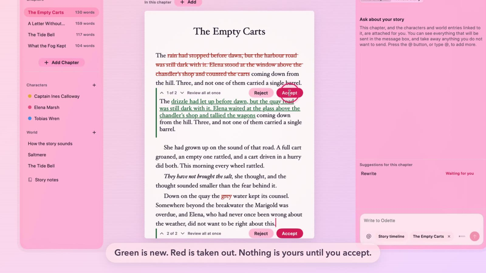
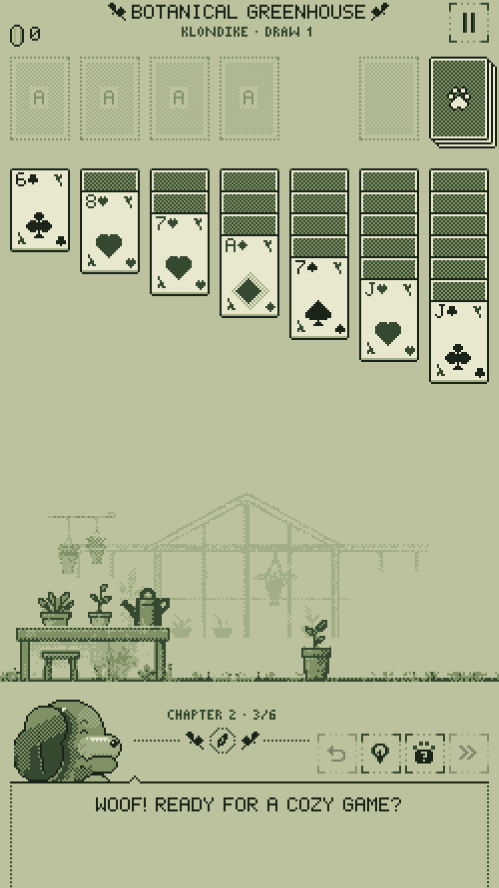
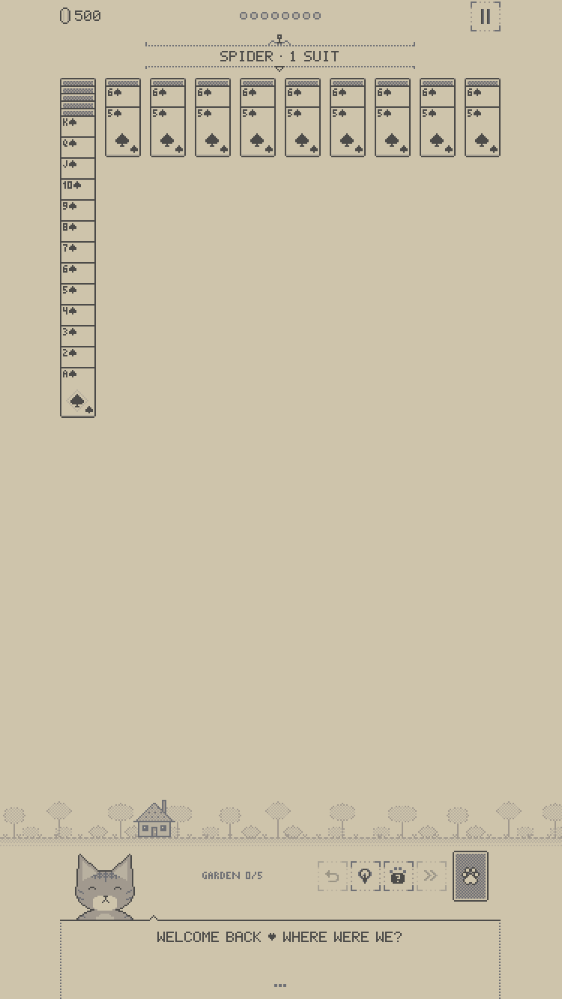
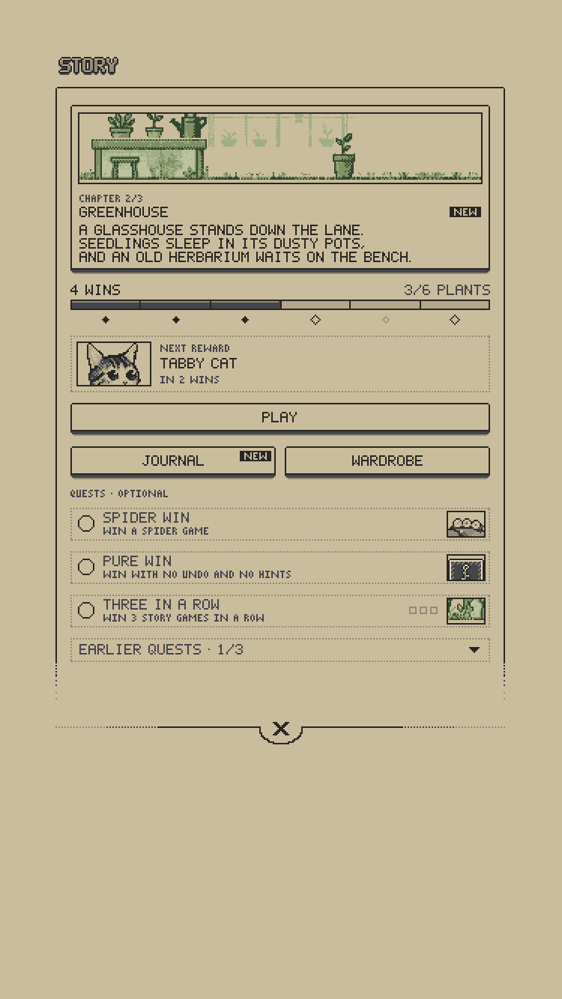
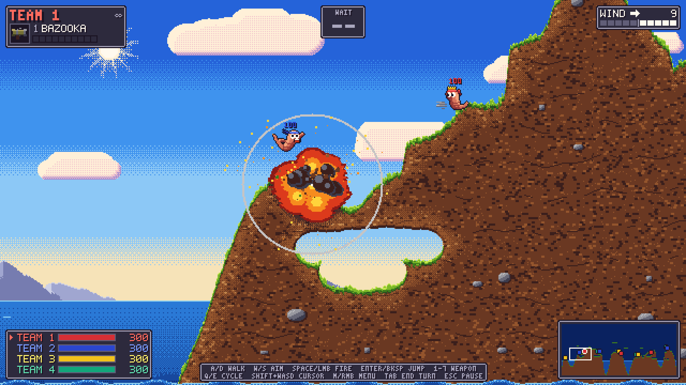

# Hi, I'm Fede

Software engineer in Córdoba, Argentina. I build web and mobile products, and these days a lot of that happens with AI agents in the loop.

Right now I'm a Mobile Engineer at **Darwoft**, building a virtual wallet for a major Argentine bank and leading the mobile design system its other apps share.

## Things I build on my own

### Novella

A Mac app for writing novels. Its assistant, Odette, can only propose edits: nothing touches a chapter until the writer accepts it.

**The hard part:** running Claude and Codex inside the app, locked down. They read the story only through an MCP server the app owns, with keys in the Keychain and the provider rules written down before the first line of code.

Swift · SwiftUI · MCP · SQLite FTS5 · macOS 26

### Spider Solitaire

  
  
  

A cozy pixel solitaire for iPhone and Mac, Klondike and Spider, with a pet that talks to you and a story that unfolds across three chapters.

**The hard part:** keeping pixel art crisp on every screen. Whole-number scaling, bitmap fonts drawn in code, a five-tone palette, and around 1,100 tests holding it together.

Swift · SwiftUI · SpriteKit · iOS · macOS

### Worms

The game I played as a kid, rebuilt from scratch in Godot without looking at the original. Seven weapons, wind, water and up to four teams on one keyboard.

**The hard part:** ground that breaks pixel by pixel, and a simulation deterministic enough that tests replay a whole match and land on the same result.

Godot · GDScript

### More

- [**LaterVault**](https://latervault.vercel.app) — Save now, decide later: links you might buy or read, on Pinterest-inspired cards with a pixel cat for company. Next.js · Drizzle · Neon
- **Lunara** — An offline sleep companion for iPhone, with soundscapes generated on the device. SwiftUI
- **Nupcia** — A wedding vendor marketplace for Argentina. Next.js · Supabase
- [**ESAM**](https://esam-instituto.vercel.app) — An editorial site for a fashion school in Córdoba. Astro
- [**Hook Hub**](https://hook-hub.vercel.app) — A catalogue of Claude Code hooks. Next.js

## Things I've built at work

- **A virtual wallet** for a major Argentine bank, using the full Expo suite (sensors, haptics, sound), plus the mobile design system behind its retail, corporate and event-ticket apps. Expo · Tamagui · Nx · Turborepo · SQLite
- **Customer and vendor apps** for a home-maintenance SaaS company, from scratch. React · Next.js · Expo · TanStack Query
- **A lending platform's MVP**, which I led on the front end from zero. Next.js · Prisma · PostgreSQL
- **A patient app** for a health association, where people track their condition, its severity and their documents. Expo · lead front end
- **Anthelios League**, a dermatology quiz league for hospitals and clinics, with teams, weekly rankings and prizes. Angular · Node.js · Prisma
- **An outsourcing marketplace** where freelancers join a talent pool and companies post projects matched by skill. React · Material UI
- **A B2B self-service panel** for a telecom's corporate customers. .NET · C# · SQL

---

[LinkedIn](https://www.linkedin.com/in/fedealetti) · [fedaletti@gmail.com](mailto:fedaletti@gmail.com)
